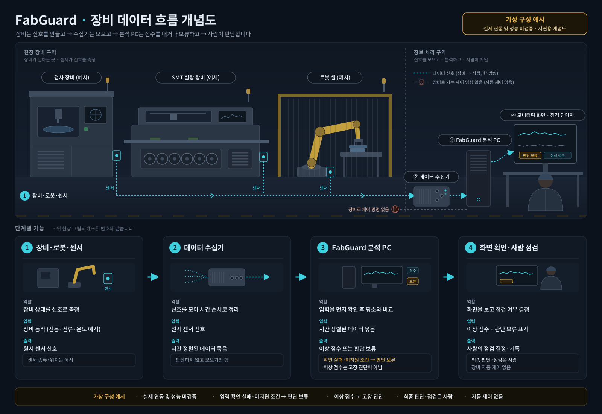

# FabGuard AI 흐름과 실패 경로

## 장비 데이터 흐름 개념도 (현재 구현과 구분)

**그림은 목표 흐름을 설명하는 가상 구성 예시이며 실제 장비 연결·현장 배포·성능 검증 증거가 아니다.** 장비로 보내는 동작 명령이나 자동 안전 제어는 없다.

- **현재:** [IMAD-DS 로봇 벤치마크](ROBOT_IMAD_BENCHMARK.md)는 저장된 센서 데이터를 이용한 별도 오프라인 실험이다. 세션 분리 target AUROC는 0.4793으로 운영 사용 근거가 없으며, 로봇 웹 화면이나 실제 로봇과 연결하지 않았다.
- **개념·미검증:** 그림의 현장 센서 수집, 수집기와 분석 PC 연결, 화면에서의 사람 점검은 설명용 목표 구성이다. 입력 확인 실패·미지원 조건에서 판단을 보류한다는 원칙을 표현하며, 그림만으로 이 전체 경로의 구현 완료를 주장하지 않는다. 이상 점수는 고장 진단이 아니며 최종 판단·점검은 사람이 한다.
- **원본 보존:** Claude가 작성한 2026-10-23 개념도의 PNG와 [편집용 SVG](assets/claude-fabguard-equipment-flow-20261023.svg)를 내용 수정 없이 보관했다. 출처 표기는 제작 도구에 관한 것이며 Claude의 성능 보증이나 검증을 뜻하지 않는다.

## 구조 선택

V1은 에이전트나 RAG가 아니라 결정적인 Python 함수·scikit-learn Pipeline의 연속이다. 모든 단계와 분기는 개발자가 정할 수 있고 모델이 다음 행동을 선택할 필요가 없다.

## 정상 흐름

1. 원본 `secom.data`와 라벨·timestamp를 읽고 파일 해시를 기록한다.
2. 행 수, 변수 수, 라벨 수, timestamp 파싱을 데이터 계약과 비교한다.
3. 시간순으로 Train 1,175건과 잠긴 Test 392건을 분리한다.
4. Train에서만 반복 층화 CV를 수행한다.
5. 각 폴드 내부에서 결측치 처리·상수 제거·스케일링·모델 학습을 수행한다.
6. Dummy, L1 Logistic, Random Forest를 동일 지표로 비교한다.
7. 선택 규칙을 문서화한 뒤 Test를 최종 1회 평가한다.
8. 위험점수, 순위, 예측, 실제 라벨, 우선 확인 변수를 priority table로 저장한다.
9. 결과표·confusion matrix·Top-K Capture·한계 문구를 보고서와 데모에 연결한다.

## 실패 경로

| 실패 | 동작 |
|---|---|
| 원본 파일 누락·해시 불일치 | 즉시 중단하고 필요한 파일과 예상 경로를 출력한다 |
| 행·열·라벨 수 불일치 | 데이터 계약 오류로 중단하고 실제 값을 기록한다 |
| timestamp 파싱 실패 | 실패 행을 보고하고 임의 순서로 대체하지 않는다 |
| 한 폴드에 Fail이 부족 | 분할을 기록하고 반복 수·전략 변경을 제안하되 자동 변경하지 않는다 |
| 전처리 후 특성이 0개 | 모델 학습을 중단하고 제거 단계별 특성 수를 출력한다 |
| 모델 확률 출력 불가 | priority table 생성을 중단하고 호환 모델 여부를 알린다 |
| 결과 디렉터리 쓰기 실패 | 기존 결과를 덮어쓰지 않고 명확한 오류로 중단한다 |
| 재현성 검증 불일치 | 릴리스를 중단하고 환경·seed·데이터 해시 차이를 기록한다 |

## 사람의 개입 지점

- 데이터 계약 또는 시간 분할 변경
- 모델 선택 기준과 threshold 결정
- Test 잠금 해제 및 최종 평가 실행
- 익명 변수 설명과 한계 문구 승인

