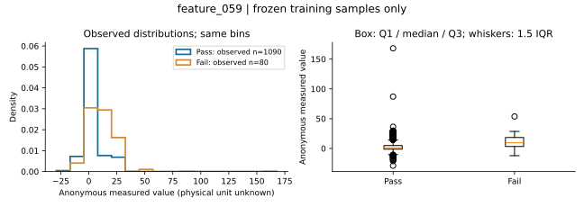
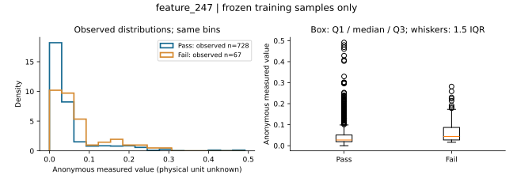
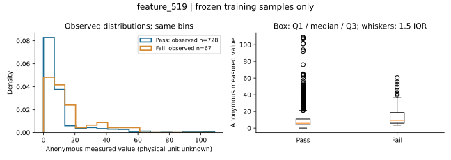
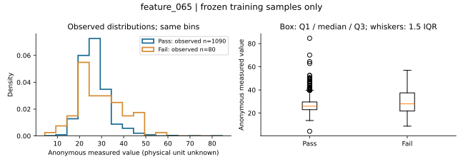
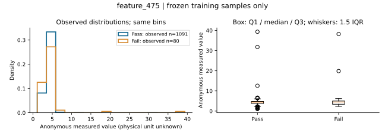

# SECOM 변수 분포 근거 보완 계약

2026-10-30 KST. 기준 main cce8360f. 5회차 강의 9·10·18·19쪽의 해석 원칙을 기존 근거 설명에 적용한다. 새 모델·평가 정의·분할·임계값·의존성 변경이 아니다.

## 계산 전에 고정한 범위

- 기존 final_model_importance.csv의 상위 5개를 그대로 설명한다: feature_059, feature_247, feature_519, feature_065, feature_475. 새 그룹 차이로 변수를 재선택/정렬하지 않는다.
- 기존 train_split.csv에 고정된 1,175개 ID만 통계·그림에 사용한다. 392개 시험 기록의 값·라벨은 통계에 사용하지 않는다. 테스트 노출 이력이 있는 기존 대표 성능은 그대로 둔다.
- 그룹: 0=Pass, 1=Fail. 원본 결측은 대치하지 않는다. 각 그룹의 전체 n·관측 n·결측 n/비율, 평균·표본표준편차(ddof=1)·5/25/50/75/95분위수를 보고한다.
- 차이 방향은 Fail - Pass다. 표준화 차이는 (Fail 평균 - Pass 평균) / 두 그룹 표본분산의 자유도 가중 pooled SD. 이는 설명용 그룹 차이이며 인과 효과나 예측 중요도가 아니다. 어느 그룹 관측 n<2 또는 pooled SD=0이면 null과 사유를 표시한다.
- 분포 비교는 두 그룹에 동일한 bin 경계를 사용하는 밀도 히스토그램·상자그림으로 제시한다. 시간별 표는 학습 자료의 달력 월 단위이며 새 모델 분할이 아니다. 그룹 n/관측 n을 함께 읽고 독립 표본/정상 안정성을 가정하지 않는다.
- p-value·새 성능·원인·실제 센서 이름은 산출/추정하지 않는다. 공정단위·물리단위 미확인. 강의 V60과 feature_059는 1-based/0-based 위치 대응일 뿐 물리적 의미를 보증하지 않는다.

## 산출물과 판정

실행기 `scripts/build_secom_distribution_evidence.py`, 통계 함수 `src/fabguard/distribution_evidence.py`.
실제 실행 후 저장되는 근거는 `docs/review/session5-20261030/`이다. JSON/CSV/그림은 학습 자료에 재노출된 탐색적 설명이지 외부 검증이나 모델 개선 증거가 아니다.

## 실제 실행 결과 (2026-10-30 KST)

학습 1,175건: Pass 1,095·Fail 80. 관측값만 계산했고 원본 결측을 대치하지 않았다. 아래 순서는 기존 모델 중요도 순서 그대로이며 새 차이에 따른 재선택이 아니다.

| 변수 | Pass 관측/전체 | Fail 관측/전체 | Pass 결측률 | Fail 결측률 | Fail - Pass 평균 차이 | 표준화 차이 |
|---|---:|---:|---:|---:|---:|---:|
| feature_059 | 1090/1095 | 80/80 | 0.46% | 0.00% | 7.6734 | 0.740 |
| feature_247 | 728/1095 | 67/80 | 33.52% | 16.25% | 0.0208 | 0.306 |
| feature_519 | 728/1095 | 67/80 | 33.52% | 16.25% | 4.4282 | 0.295 |
| feature_065 | 1090/1095 | 80/80 | 0.46% | 0.00% | 2.3150 | 0.340 |
| feature_475 | 1091/1095 | 80/80 | 0.37% | 0.00% | 0.5629 | 0.295 |

표준화 차이는 평균 차이를 공통 표준편차 단위로 나타낸 설명량이다. 물리 단위·고장 원인·예측 성능이 아니다. 서로 다른 익명 변수의 원시 평균 차이는 직접 순위를 매기지 않는다.

**읽을 점:** feature_247/519는 두 그룹의 결측률 차이가 크다. 보이는 값만의 차이를 전체 그룹의 차이로 일반화하면 안 된다. 결측이 생긴 원인도 이 결과만으로 확정할 수 없다. feature_059의 월별 Fail - Pass 평균 차이는 7월 약8.837, 8월3.442, 9월7.431로 달라진다. 해당 월 Fail n은14/51/15다. 방향이 같아도 시간·표본 구성의 영향을 제거한 것은 아니다. 이 차이로 모델이나 임계값을 조정하지 않았다.

### 분포 그림: 한 그래프마다 확인할 질문

**feature_059: 두 그룹이 얼마나 겹치고, 꼬리·퍼짐이 평균 차이를 어떻게 설명하는가?**



**feature_247: 두 그룹이 얼마나 겹치고, 꼬리·퍼짐이 평균 차이를 어떻게 설명하는가?**



**feature_519: 두 그룹이 얼마나 겹치고, 꼬리·퍼짐이 평균 차이를 어떻게 설명하는가?**



**feature_065: 두 그룹이 얼마나 겹치고, 꼬리·퍼짐이 평균 차이를 어떻게 설명하는가?**



**feature_475: 두 그룹이 얼마나 겹치고, 꼬리·퍼짐이 평균 차이를 어떻게 설명하는가?**



### 재현과 근거

```bash
PYTHONPATH=src python scripts/build_secom_distribution_evidence.py --data-dir /path/to/official/secom
```

공식 원본은 [UCI SECOM](https://archive.ics.uci.edu/dataset/179/secom)에서 받는다. 기존 소스 코드의 원본 SHA-256 계약을 그대로 검증한다. 새 원본 파일을 저장소에 올리지 않는다.

- [그룹별 통계·고정 입력 및 원본 해시·환경](review/session5-20261030/summary.json)
- [그룹별 CSV](review/session5-20261030/group_summary.csv) · [학습 월별 CSV](review/session5-20261030/monthly_summary.csv)
- [실행·회귀검사·한계](review/session5-20261030/VALIDATION.md)

이 보고서는 모델 적합에 쓴 자료를 다시 설명한 탐색 결과다. 독립 검증, 변수 재선정, 새 원인 발견, 시험셋 성능 향상으로 인용하지 않는다. 웹 UI에는 아직 연결하지 않았다.
